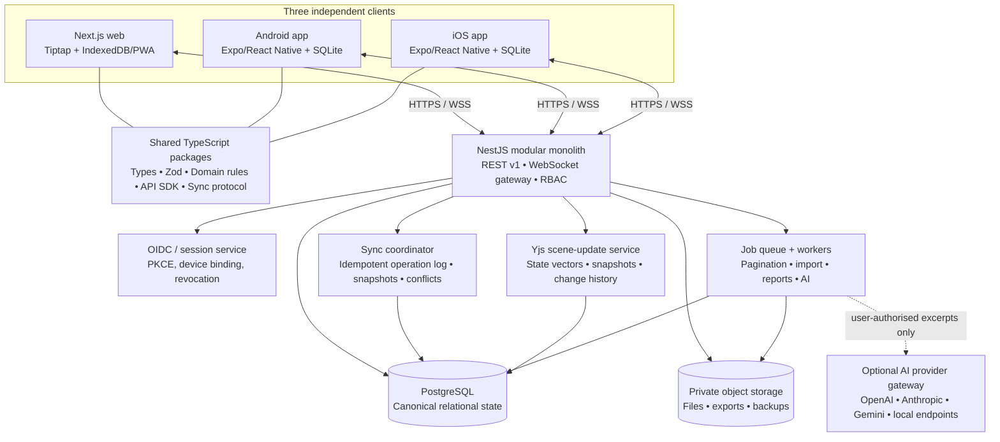
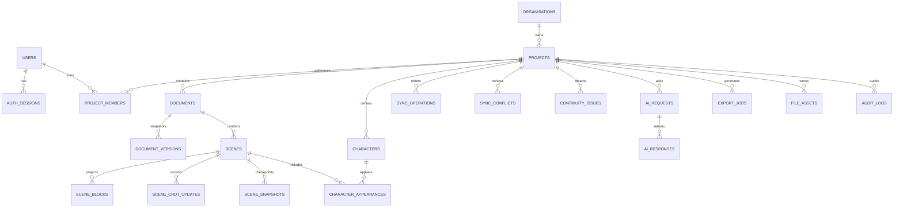

# STORYFORGE STUDIO — Cross-Platform Architecture Baseline

**Status:** Architecture proposal / implementation gate, not a working application  
**Revision:** 1.0 — 13 November 2026  
**Scope:** Responsive Next.js web + dedicated React Native/Expo Android and iOS + shared NestJS/PostgreSQL platform  
**Authority:** Mandatory platform update prevails on deployment architecture; all original creative, production, security, quality and multilingual requirements remain in the product backlog.

## 1. Product requirements and scope invariants

Storyforge Studio is an original professional film-development platform, not an editor with a chatbot attached. The complete scope covers all **19 original modules**: (1) screenplay editor; (2) story development; (3) characters; (4) scenes and sequences; (5) continuity; (6) AI intelligence; (7) AI-powered film development and pitches; (8) production breakdown; (9) budget; (10) collaboration and revisions; (11) export; (12) projects/portfolio; (13) UX; (14) search/knowledge; (15) IP protection; (16) import/migration; (17) performance/reliability; (18) testing; and (19) extensibility. Nothing has been removed; delivery is phased.

### Non-negotiable acceptance invariants

- Browser, Android and iOS are independent products with their own tested routes/screens, native builds where appropriate, and the **same identity, projects, documents, characters, scenes, revisions and AI history**.
- Offline writing works after the relevant client has been installed/loaded; an already-authenticated mobile user can create a project and write without connectivity. PWA offline creation requires prior app caching/activation. First-ever account registration and cloud collaboration require a network connection; do not falsely promise otherwise.
- Typed screenplay blocks, stable scene IDs, reversibility, autosave/recovery, accurate Unicode and professional deterministic layout; no dependence on a model API for core operations.
- All new local edits are recorded durably **before** a UI says they are saved. A sync acknowledgement is separate from a local-save confirmation.
- All AI suggestions require review and an explicit accept action. Users see the exact content intended for a provider before transmission.
- No silent conflict resolution that destroys either edit, no unverified production estimates, no fake buttons or dummy data advertised as real functionality.
- Prior desktop/Tauri packaging becomes an **optional later distribution channel** only. Desktop-class writing functionality is delivered on the web, not removed.

## 2. Technology selection report

| Layer | Decision | Reason / constraint |
|---|---|---|
| Web | Next.js App Router + React + TypeScript | Desktop-optimised writer, SSR where appropriate; actual editing is a client-side view |
| Mobile | Expo + React Native + TypeScript; Expo Router | Dedicated native navigation, secure storage, background/foreground lifecycle |
| API | NestJS modular monolith on Node.js | REST/OpenAPI, consistent auth/policies, WebSocket gateway, queue workers |
| Canonical database | PostgreSQL | ACID transactions, revisions, strong relational consistency, RLS defense-in-depth |
| Mobile offline | SQLite via `expo-sqlite`, encrypted-at-rest adapter assessed during security spike | Durable domain cache, outbound operation queue, recovery |
| Web offline | Service worker/PWA shell + IndexedDB (Dexie-equivalent adapter) | Local edit queue and offline drafting after first visit; browser eviction risk disclosed |
| Web editor | Tiptap/ProseMirror + original screenplay nodes | Structured keyboard-first editing; not a plain-text textarea |
| Mobile editor | React Native scene navigator/controls + tested screenplay editing surface | Prefer native blocks; test Tiptap-in-WebView bridge for complex rich text before deciding. **WebView inside a native app is not a responsive website replacement** |
| Collaborative text | Yjs CRDT document **per scene**, versioned and persisted | Offline and concurrent text merges; verify identical content semantics on RN |
| Structured mutation sync | Outbox + idempotent REST + optimistic versions | Detect metadata/reorder/delete conflicts and allow explicit resolution |
| Queue / jobs | Redis-backed worker (e.g., BullMQ) | Async AI, PDF, import/export; not in the typing path |
| File storage | Private S3-compatible object store + signed short-lived downloads | Versioned user attachments, exports, backups |
| Schema / contracts | SQL migration files + Zod/JSON Schema + generated OpenAPI client | One schema and API definition, multiple UIs; no duplicated rules |
| Monorepo | pnpm workspaces + Turborepo or equivalent | Shared workspace code and isolated builds |
| Observability | OpenTelemetry, structured logs and error reporting with redaction | Reproducible cross-device sync diagnosis without logging screenplay text |

**Version policy:** Lock the currently compatible stable releases in the actual lockfile at implementation time, run Expo SDK compatibility checks, and test supported Node LTS versions. Do not assume all latest packages interoperate automatically.

**Important unresolved spike:** The exact mobile editor binding, encrypted SQLite implementation, and canonical Telugu pagination renderer must pass device-level prototypes before the architecture is frozen. `expo-secure-store` is for small credentials, **not** storing a screenplay database. SQLCipher/OS data-protection support requires a supported native integration and real-device validation.

### High-level architecture diagram



### Deployable boundaries

1. **Web frontend:** Next.js independently deployed behind CDN/TLS. Route handlers may act as a BFF for web cookies but must not fork domain logic.
2. **Android and iOS:** Two independently signed/tested binaries from one Expo mobile workspace, separate platform validation and release pipelines.
3. **API:** One initial NestJS deployable modular monolith and separate worker process sharing packages. Do not introduce microservices until measured need.
4. **Data:** PostgreSQL primary + tested PITR strategy, Redis queue/pubsub, private object storage, managed secrets/KMS. All external collaboration calls authenticated.
5. **Optional desktop:** Future Tauri wrapper can reuse web editor and APIs, but is not required for initial web/Android/iOS milestones.

## 3. Monorepo layout (proposed)

```text
storyforge-studio/
├── apps/
│   ├── web/                       # Next.js App Router, web editor, PWA
│   │   ├── app/(auth)/
│   │   ├── app/(studio)/projects/[projectId]/
│   │   ├── components/editor/
│   │   ├── components/story/
│   │   ├── features/offline/
│   │   └── tests/e2e/
│   ├── mobile/                    # Expo Router, separate Android/iOS builds
│   │   ├── app/(auth)/
│   │   ├── app/(tabs)/
│   │   ├── features/editor/
│   │   ├── features/offline-sqlite/
│   │   ├── native-bridges/        # only if editor/rendering spikes require it
│   │   ├── assets/fonts/          # licensed bundled font subsets
│   │   ├── android/ and ios/      # if prebuild/native modules are needed
│   │   └── tests/device/
│   └── api/                       # NestJS HTTP + WS, auth/policies
│       ├── src/modules/{auth,users,organisations,projects,story}/
│       ├── src/modules/{documents,scenes,characters,sync,crdt}/
│       ├── src/modules/{continuity,ai,exports,production,budget}/
│       ├── src/modules/{search,files,teams,billing,audit}/
│       ├── src/common/{guards,filters,interceptors}/
│       └── tests/{integration,contract,e2e}/
├── workers/
│   └── jobs/                      # PDF, reports, imports, AI queue consumers
├── packages/
│   ├── contracts/                 # Zod/JSON schemas, OpenAPI outputs
│   ├── domain/                    # typed entities, story rules, validations
│   ├── screenplay-model/          # blocks, scene AST, migrations, import maps
│   ├── sync-core/                 # op-log, conflict types, cursor protocol
│   ├── editor-bridge/             # shared transforms/optional WebView protocol
│   ├── api-client/                # generated typed fetch client
│   ├── auth-client/               # flow definitions; platform adapters
│   ├── pagination/                # deterministic layout specification/engine
│   ├── localization/              # Telugu-first + seven initial languages
│   ├── design-tokens/             # shared tokens, not duplicate UI components
│   └── test-fixtures/             # permitted synthetic test scripts
├── infra/
│   ├── database/migrations/
│   ├── docker/                    # local development only
│   ├── terraform/                 # cloud infra IaC
│   └── monitoring/
├── docs/
│   ├── adr/
│   ├── architecture/
│   ├── api/
│   ├── security/
│   ├── ux/
│   ├── release/
│   └── qa/
├── .github/workflows/
├── package.json
├── pnpm-workspace.yaml
├── turbo.json
├── tsconfig.base.json
└── .env.example
```

**Package boundaries:** `domain`, `contracts`, `screenplay-model` and `sync-core` have no React, native, Nest or PostgreSQL imports. Storage/auth/network are platform adapters. Web and mobile retain **different UI components** while reusing decisions and state machines. Any rule implemented in a client must also be enforced server-side for security.

## 4. Canonical screenplay and data model

### Typed screenplay document

- `Project` owns `Document`; document has `DocumentVersion`, `Scene` and stable scene IDs.
- A scene has metadata (`intExt`, location, timeOfDay, purpose, act, sequence, position), a **Yjs collaborative scene document**, and queryable `SceneBlock` projections.
- Scene blocks have distinct `blockType` values: `scene_heading`, `action`, `character_intro`, `character_cue`, `dialogue`, `parenthetical`, `voice_over`, `off_screen`, `transition`, `montage`, `flashback`, `dream_sequence`, `intercut`, `shot`, `super`, `sound_cue`, `camera_direction`, `scene_continuation`.
- Block content uses structured text spans/marks; never make one giant unstructured screenplay TEXT column the canonical source.
- Stable UUIDs identify acts, sequences, scenes, characters and blocks. Scene **numbers** are derived/revision-aware display fields; reordering may change numbers but not IDs.
- Character appearances, word counts, indexes, production elements and exports are **versioned projections** computed from accepted document state. Rebuild jobs must be idempotent.
- Links between entities must have same-project constraints, including composite `(project_id, id)` FKs. Deleted scenes become tombstones before later purge.

### Conceptual ER diagram (expanded SQL in `001_core.sql`)



### Complete entity inventory (by domain)

| Domain | Planned canonical entities |
|---|---|
| Identity/enterprise | Users, AuthIdentities, Sessions, Devices, Organisations, OrganisationMembers, Projects, ProjectMembers, Roles/Permissions, Subscriptions/Entitlements |
| Story | Documents, DocumentVersions, Acts, Sequences, Scenes, SceneBlocks, StoryBeats, StoryThreads, NarrativeTimelines, SceneTags, SceneNotes |
| Character | Characters, CharacterAliases, CharacterRelationships, CharacterAppearances, CharacterArcs |
| Production | Locations, SceneElements, Props, Costumes, Vehicles, ProductionBreakdowns, ShootingSchedules, ScheduleItems, BudgetItems, BudgetRates, ProductionAssumptions |
| Continuity | ContinuityFacts, ContinuityIssues, ContinuityExceptions, SceneFactLinks |
| AI/knowledge | AIProviderConfigurations, AIRequests, AIResponses, AIUsageRecords, AIProposalReviews, KnowledgeAssets, Embeddings (optional) |
| Collaboration | Comments, Annotations, SceneCRDTUpdates, SceneSnapshots, SyncOperations, SyncDeviceCursors, SyncConflicts, Invitations, RevisionApprovals |
| Files/audit | FileAssets, ExportJobs, ExportFiles, Backups, ImportJobs, AuditLogs, DeletionJobs |

The included SQL migration implements the **foundation/Core** relational entities; later additive migrations implement remaining conceptual entities before their module ships. Future module tables are not claimed to be already created.

### Data integrity / retention

- PostgreSQL UUID primary keys; `project_id` on project-owned entities; unique composite keys `(project_id, id)` for tenant-safe foreign references.
- `deleted_at` soft deletion on user-editable content with recovery workflow. A deletion request can require permanent storage erasure after legal/backup retention review.
- Transactions allocate `projects.server_revision` monotonically for sync writes; unique `(project_id, server_revision)` in operation log.
- CRDT updates recorded with unique `operation_id`; compaction checkpoints include state vectors and an explicitly documented replay cutoff.
- Indexes on tenant/scenes position, document, appearances, operation revisions, modified timestamps and searchable projections. Telugu search uses Unicode-aware tokenization and normalized auxiliary index without altering original text.
- Migrations are forward-only per release, reviewed, rehearsed on snapshot replicas and backwards-compatible during rolling deploys. Every migration has an expand → backfill → contract strategy.
- Audit data minimization: log action, actor, target, timestamp and outcome, not screenplay dialogue bodies or provider credentials.

## 5. Offline and synchronization protocol — authoritative design

**Local write path:** edit → locally transactional persistence (SQLite/IndexedDB + outbox entry) → show **Saved locally** → on connection/auth → push outbox → server validate/auth/idempotency + apply → acknowledge → pull missing operations → update local materialized state → show **Synced**. If a device is offline, locally queued content is never dropped to make a sync screen look clean.

### Operation envelope

```json
{
  "opId": "client-generated-uuid",
  "projectId": "project-uuid",
  "deviceId": "device-uuid",
  "clientSequence": 148,
  "entityType": "scene",
  "entityId": "scene-uuid",
  "kind": "scene.metadata.patch",
  "baseVersion": 12,
  "payload": { "timeOfDay": "NIGHT" },
  "createdAtClient": "ISO-8601 timestamp"
}
```

CRDT text operations use `kind: scene.crdt.update` and `crdtUpdateBase64` (HTTP transport) or binary WebSocket frames, subject to a bounded update size and server-side validation. Each scene has its own Yjs document, not one enormous global document. The server stores updates and deterministic/snapshot projections, and broadcasts invalidation/update notifications only to authorized project rooms.

### Sync algorithm

1. Authenticate, fetch scoped membership/permissions, load `deviceId`, persisted cursor, and queued writes.
2. `POST /v1/sync/push` with bounded batch and stable `opId`/`clientSequence`. Server checks permissions, expected version for structured changes, unique op IDs, entity existence and project membership. **No blind last-write-wins**.
3. Reply per operation with `applied`, `already_applied`, `conflict`, or `rejected` and authoritative revision. Idempotent resend cannot duplicate a scene or charge twice.
4. `GET /v1/sync/pull?projectId=...&cursor=...&limit=...` returns ordered operations, tombstones, new cursor and `hasMore`; include compacted-scene snapshot instructions if a cursor is too old.
5. Apply pulled changes transactionally locally, deduplicate by `opId`, then advance durable cursor. Acknowledge safe retention using `POST /v1/sync/ack`.
6. WebSocket events `project.changed` or `scene.crdt.update` prompt realtime updates; REST pull remains authoritative after disconnect. Use exponential retry/jitter, connectivity awareness, and background task scheduling only as opportunistic optimization.
7. Retain local unsent operations and base snapshots on `409 conflict`, revoked permission, expiring login, missing dependencies or server failure. Present explicit recovery/export options.

### Conflict policy matrix

| Concurrent activity | Policy |
|---|---|
| Two users typing in same scene text | Yjs merges concurrent text edits; user can inspect authorship and revisions; semantic conflicts still reviewable |
| Different fields in same scene metadata | Apply non-overlapping changes if server proves base versions and field history; otherwise review |
| Same field updated to different values | Explicit conflict object with base/local/server and manual choice/merge |
| Scene reorder | Server serializes relative move operations with stable scene UUIDs; concurrent incompatible placements require a review state |
| Scene delete vs offline edit | Preserve offline content as recoverable branch; never discard it silently |
| Project membership revoked while offline | Reject push; retain encrypted local copy temporarily under policy and offer owner-approved export/reconciliation; prevent further network access |
| Draft revision restored while another editor works | Restoration creates new immutable version, never overwrites another person's unseen work |

**Note on CRDTs:** CRDT convergence prevents syntactic data loss; it does not guarantee narrative coherence. Review controls, snapshot history and a `Sync Center` remain mandatory.

## 6. Authentication / authorization / privacy architecture

- OpenID Connect/OAuth 2.0 with Authorization Code + PKCE for mobile and browser; first-party email/passkey support as provider policy allows; same user UUID across platforms.
- Browser: secure HttpOnly SameSite cookies, CSRF protections and token rotation through BFF; avoid persistent browser JS-readable refresh tokens.
- Mobile: short-lived access token in memory, refresh credentials in Keychain/Keystore via SecureStore; register and revoke each device, test biometric/app-lock interaction independently.
- Server: every REST/WS/SSE/worker operation validates caller, project membership and scoped permission; organization isolation and optional PostgreSQL RLS guard against accidental cross-tenant queries.
- AI BYOK: secrets encrypted under KMS-managed envelope key on the server; secret never returned in GET; mask in UI; run provider call only server-side with data-minimization preview and explicit user permission. Usage metering and per-project budget guard.
- Local: on-device encrypted persistence where supported/validated; encrypted export/backup; no complete screenplay in analytics/crash logs. Web IndexedDB storage is not equivalent to mobile hardware-backed encryption; document the limitation.
- Cloud: TLS, KMS/object encryption, signed upload/download URLs with ownership checks, file scanning, quota/rate limits, PITR, restore tests, secure deletion policy, signed artifact retention.
- Tenant-context is bound at both API and database layers; `.organizationId` is not accepted as proof of authorization from a client.

### Security threat model (initial)

| Threat | Control | Gate |
|---|---|---|
| Cross-project data disclosure | Scoped SQL composite FKs, auth guard, policy tests, RLS defense-in-depth | Tests of read/write/export/WS leakage |
| Token stolen / replay | PKCE, short access TTL, rotated hashed refresh credentials, device revoke | Replay and device-revoke tests |
| Offline operation replay / double creation | Unique op ID/device sequence, auth on every batch | Idempotency and retry tests |
| Malicious import / payload | MIME sniffing, file limits, parsers in sandbox, malware scanning | Fuzz corpus / zip bomb tests |
| AI prompt leakage / excessive upload | Explicit excerpt selection, project isolation, usage budgets, redaction | Inspect actual provider request traces (without content logs) |
| Supply-chain compromise | Lockfile, SBOM, dependency/scanning, least-privilege CI, signed builds | Release gate |
| Ransomware / data loss | Immutable encrypted backups, point-in-time recovery, local export | Restore drill and corruption test |
| Insider/admin overreach | Least privilege, audit log, access review, documented break-glass | Security review |

## 7. API specification (contract overview)

**Base:** `/v1`, JSON over HTTPS with bearer token/mobile or secure web session; UUID entities; ISO 8601 timestamps; snake/camel naming fixed as **camelCase** in network JSON. OpenAPI draft provided in `openapi.yaml`.

| Resource | Routes (initial contract) | Behaviors |
|---|---|---|
| Auth | `POST /auth/exchange`, `/auth/refresh`, `/auth/logout`; `GET /me` | OIDC exchange; refresh rotation; device sessions |
| Projects | `GET, POST /projects`; `GET, PATCH /projects/{id}` | Account-scoped list/create/update and optimistic version |
| Documents | `GET, POST /projects/{id}/documents`; `GET /documents/{id}` | Structured screenplay documents |
| Scenes | `GET, POST /documents/{id}/scenes`; `PATCH /scenes/{id}`; `POST /scenes/{id}/move` | Stable scene IDs, typed metadata, version checks |
| Characters | `GET, POST /projects/{id}/characters` | Structured character profiles |
| Sync | `POST /sync/push`, `/sync/ack`; `GET /sync/pull` | Idempotent op log, conflict response, durable cursor |
| Collaboration | `GET /projects/{id}/conflicts`; `POST /conflicts/{id}/resolve` | No silent overwrite |
| AI | `POST /projects/{id}/ai/requests`; `GET /projects/{id}/ai/history` | Consent/selected scope and safe suggestion review |
| Exports | `POST /documents/{id}/exports`; `GET /exports/{id}` | Asynchronous PDF/DOCX/etc with worker status |
| Files | `POST /projects/{id}/files/uploads`; `GET /files/{id}/download` | Signed scoped object access |
| Teams / billing (reserved) | `/organizations`, `/memberships`, `/subscriptions`, `/entitlements` | Entitlement enforcement and migration-ready structure |

**Headers:** `Idempotency-Key` for create/join and sync requests; `If-Match`/`baseVersion` for optimistic mutations; `X-Request-Id` for support diagnostics. Standard error object includes `code`, `message`, `requestId`, optional `details`; `409` includes a resolvable conflict descriptor and `403` is a real permissions failure. Cursor tokens are opaque and tenant-bound.

**WebSocket:** `/v1/realtime` with short-lived authenticated token and reauthorization on room join. Events `project.changed`, `scene.crdt.update`, `presence.changed`, `comment.created`, `export.updated`, `ai.request.updated`; resume through REST sync to recover missing messages. Presence is ephemeral, not authoritative text state. Apply event rate/size limits, and never trust client-supplied tenant room names.

### Illustrative network response

```json
{
  "results": [
    { "opId": "client-generated-uuid", "status": "applied", "serverRevision": 27 },
    { "opId": "other-op-uuid", "status": "conflict", "conflictId": "conflict-uuid" }
  ],
  "latestServerRevision": 27
}
```

## 8. UI navigation, wireframes, component inventory

### Web navigation

`Dashboard → Projects → Project workspace` with tabs/panels: `Story Studio`, `Screenplay Editor`, `Characters`, `Scene Board`, `Continuity`, `AI Studio`, `Production`, `Budget`, `Reports`, `Settings`, `Sync Center`.

```text
┌──────────────────────────── STORYFORGE / PROJECT TITLE ─────────────────────────────┐
│ Project • Draft 03 • Saved locally / Synced ✓ • Collaborators • Export • Settings  │
├───────────────────┬──────────────────────────────────┬─────────────────────────────┤
│ SCENE NAVIGATOR   │ SCREENPLAY EDITOR                │ CONTEXT (collapsible)       │
│ Act I             │ [Scene 001]                      │ Scene metadata              │
│  001 — Ravi House │ INT. రవి ఇల్లు — రాత్రి           │ Character references        │
│  002 — Market     │                                  │ Continuity warnings         │
│ Act II            │ RAVI                            │ Comments & review           │
│ ...               │ నేను రేపు వస్తాను.              │ AI (only when summoned)     │
├───────────────────┴──────────────────────────────────┴─────────────────────────────┤
│ Page preview • Shortcuts • Writing focus • Undo/Redo • Draft comparison            │
└────────────────────────────────────────────────────────────────────────────────────┘
```

### Mobile navigation

`Home/Projects → Project → Read/Write → Scenes → Capture → Review → More`; context sheets for scene metadata, comment/revision, sync conflicts and AI. Android/iOS separately test native back/swipe, keyboard, IME, share sheet, system theme and local notification permissions.

```text
┌─────────────────────────┐
│ ‹ MOVIE 01   Saved local│
│ Scene 12 / 88        ⋯  │
├─────────────────────────┤
│ INT. హాల్ — రాత్రి       │
│                         │
│ [Typed block editor]    │
│ [Native Telugu IME]     │
│                         │
├─────────────────────────┤
│ ◀ Scene 12 ▶   + Block  │
│ Read  Write  Notes      │
│ Home  Scenes Capture ...│
└─────────────────────────┘
```

### Component inventory

Shared state machines and models: auth session, project selection, scene navigator, document operation, local outbox, conflict resolver, AI proposal review, export job status, user entitlement. Web-specific: ProseMirror scene renderer, page preview, scene outline, resizable panels, drag/drop board, desktop shortcuts. Mobile-specific: offline-aware scene screen, idea capture, native text input/editor bridge, attachment share sheet, sync queue inspector, native swipe/navigation, mobile review sheet.

**Every visible action** requires a real API/local command, loading state, error state, permission state, retry path and documented acceptance test; features not shipped are disabled or hidden and clearly marked on roadmap—not dummy interactive screens.

## 9. AI provider and review architecture

`User selects scenes → client previews data to transmit → explicit consent → authorized API request → AI job records scope/cost limit → server extracts allowed context and calls selected provider → response stored as proposal with scene references → side-by-side review → accept/reject/edit creates new authenticated document operation.`

Provider adapters implement `validateConfig`, `estimateCost`, `runStructured`, `stream`, `normalizeError` and configurable timeout/retry. Begin with OpenAI, Anthropic, Gemini, OpenAI-compatible endpoint and local endpoints when reachable from the user's configured environment. Store provider configs per project/user with encrypted secret; never include key in response, logs or device SQLite. Support Telugu conversational/Andhra/Telangana/Rayalaseema speech, character voice/dialect guidance and non-coercive alternative dialogue. Expose actual usage history and spend ceilings.

## 10. Deterministic pagination, fonts, exports

- Canonical page model has locked page size/margins, typed block metrics, named font versions, line-break rules, dialogue/character keep-together constraints, explicit breaks and scene continuations.
- **Rendering architecture spike:** compare a shared Unicode shaping/layout core (e.g., HarfBuzz-backed engine compiled where needed) versus server-generated canonical layout manifests and locally deterministic renderer. The accepted engine must work offline for required client export modes; web, Android and iOS output must be verified against identical golden tests.
- Never rely on `window.print()` as the primary screenplay paginator. Never call a PDF generator Unicode-compliant until conjuncts/ligatures, font subsets, search/copy-paste and line wrapping are validated against actual PDFs.
- Telugu presets must be readable and not force Latin Courier defaults. International/Telugu literary/industry/shooting/producer/confidential presets remain separate.
- Exports: editable DOCX, PDF, TXT, Fountain, tested FDX-compatible interchange, CSV and multi-sheet XLSX with formulas/filters where relevant. Import original DOCX/PDF/TXT/Fountain/FDX, retain source, permit structured corrections and flag unclassified text.
- Fonts must have appropriate embedding/distribution licences. No proprietary competitor styles/assets copied.

## 11. Testing and release strategy

| Layer | Required evidence before calling it built |
|---|---|
| Domain | Block parser, ordering, character indexing, continuity, Unicode, versions, property-based/invariant tests |
| Backend | API integration + real PostgreSQL migrations; auth/tenant negative tests, rate limit and webhook abuse |
| Web | Playwright: login, create project, write, offline refresh, reopen, conflict, PDF export, screen reader/keyboard |
| Android | Real emulator and device tests: native IME, SQLite durability, crash kill, offline edits, sync, export/display |
| iOS | Real simulator and device tests: Telugu IME, keyboard composition, app background/kill, sync, export/display |
| Synchronization | Network partition, multi-device concurrent edits, duplicate operations, reordering, stale cursor, delete-vs-edit |
| Collaboration | Two editors + offline third client; deterministic replay and access revoked mid-session |
| AI | Real test-provider credentials in secure CI; timeout, refusal, cost ceilings, deliberate review, data scope tests |
| PDF | Pixel/structure diff goldens; Telugu ligatures, embedded glyphs, non-clipping, pagination, search and copy tests |
| Release | SAST, dependency scan, SBOM, secrets scan, backup restore, telemetry redaction, staged rollout, rollback |

Telugu golden corpus: `అక్షరాలు`, `గుణింతాలు`, `వత్తులు`, `సంయుక్తాక్షరాలు`, `దీర్ఘాలు`, punctuation, Telugu numerals, Latin/code switching, long dialogs, long scene descriptions, punctuation and copy/paste roundtrips. Repeat across multiple Android and iOS OS versions plus desktop browsers. Test local saving under process termination and under full storage conditions.

**Initial engineering service budgets are hypotheses, not measured promises:** 95th percentile editor keystroke-to-visible response under 50 ms on target devices; local transaction median under 200 ms; 99.99% acknowledged sync operations recoverable under replay; 0 data loss on intentional crash/network test corpus. Calibrate after baseline hardware selection.

## 12. Development roadmap and gated milestones

Reordered to satisfy the mandatory **backend → web → mobile** instruction, while retaining all original six broad feature phases. A milestone only passes when acceptance evidence is attached.

| Milestone | Build order / work package | Concrete exit criteria |
|---|---|---|
| M0 — Architecture & critical spikes | Approve PRD/ERD/OpenAPI, threat model, sync strategy, Telugu pagination proof, mobile editor/crypto feasibility | Decisions recorded; no blockers to implementation; cross-platform Telugu golden sample renders; contract reviewed |
| M1 — Shared foundation (first implementation) | Monorepo, NestJS modules, PostgreSQL migrations, login/refresh/device, project/document/scene APIs, sync op log, permission boundaries, CI | Auth and real persistent read/write integration tests; documented API; migration up/down recovery plan |
| M2 — Professional web core | Next.js app, project dashboard, Tiptap structured editor, characters/scenes, local outbox, basic import/export, PDF, recovery | Real offline draft then sync; save/reopen/export Telugu screenplay; no LLM key required |
| M3 — Dedicated Android core | Expo RN navigation, SQLite outbox, typed scene editing, account/projects, sync/conflicts, capture/review, Telugu QA | Signed installable Android test build, actual offline edit/relaunch/sync, stable scene IDs |
| M4 — Dedicated iOS core | Shared RN domain/UI with iOS integrations, safe-area/keyboard, secure storage, sync, Telugu QA | Signed iOS TestFlight/internal build, same offline/crash/sync/export acceptance independently verified |
| M5 — Story intelligence (original Phase 2) | Story bible, outline/beat cards, sequence board, relationships, analytics, pagination hardening, revisions | End-to-end story → numbered scenes → editable professional draft |
| M6 — AI studio (original Phase 3) | BYOK adapters, key vault, selected-context preview, Telugu writing/coverage, AI usage and proposal review | Real provider operation, limits, no automatic edits, reference-backed suggestions |
| M7 — Production operations (original Phase 4) | Breakdowns, elements, scheduling, budget, reports and XLSX | Editable reports generated from real accepted scenes, documented assumptions |
| M8 — Collaboration & enterprise (original Phase 5) | Multi-user permissions, presence, comments, approvals, cloud lifecycle, organisations, subscription entitlement groundwork | Three-client conflict/revoke tests, audit, tenant isolation, revision approvals |
| M9 — Advanced modules (original Phase 6) | Knowledge search, expanded multilingual, advanced coverage, pitch packages, interoperability, plugins | Feature-specific acceptance suites and privacy review |

**Reconciliation of original phase plan:** Phase 1 is distributed over M1–M4 because a cross-platform release requires separate delivery gates. The later feature phases are retained in M5–M9. Foundational secure synchronization arrives early, whereas advanced concurrent multi-user collaboration/enterprise controls mature at M8.

**Independent build artifacts:** Web deployment URL/build manifest; Android signed APK/AAB; iOS signed IPA/TestFlight; API container image and migration artifact. Each requires reproducible version tags, smoke-test results, release notes and rollback instructions. No platform is declared released solely because another one passed.

## 13. Developer setup, configuration and deployment plan

**Environment inspection (current architecture workspace):** Node `v22.16.0`, npm `10.9.2`, Corepack available; no `pnpm`, Docker daemon/CLI, PostgreSQL client/server, Rust or Cargo detected. There was no existing source repository in the supplied folder—only the master prompt. These documents do not constitute an implemented or tested product.

### Local setup once implementation begins

1. Install required Node LTS, Corepack/pnpm pinned in `packageManager`, Docker/Podman or local PostgreSQL and Redis, Android Studio, and macOS/Xcode for native iOS local builds (or use the supported hosted iOS build service).
2. `corepack enable && pnpm install --frozen-lockfile` after repository creation.
3. Copy `.env.example` to a **local, ignored** `.env` and populate real development values from a secret store; never commit production keys.
4. Start PostgreSQL, Redis and S3-compatible local object storage; run `pnpm db:migrate` after migrations are reviewed.
5. Run `pnpm --filter api dev`, `pnpm --filter web dev`, `pnpm --filter mobile start` and the worker (scripts defined in implementation).
6. Verify health, OpenAPI document, one real login and one project save/reopen; run contract, unit, integration, browser and device suites.
7. Build the Next.js deployment and two distinct mobile signed binaries; validate against staging backend before production.

**Environment variable contract (names only):** `DATABASE_URL`, `REDIS_URL`, `OBJECT_STORAGE_ENDPOINT`, `OBJECT_STORAGE_BUCKET`, `OBJECT_STORAGE_ACCESS_KEY_ID`, `OBJECT_STORAGE_SECRET_ACCESS_KEY`, `OIDC_ISSUER_URL`, `OIDC_CLIENT_ID`, `OIDC_AUDIENCE`, `SESSION_SIGNING_KEY_REF`, `ENCRYPTION_KMS_KEY_ID`, `PUBLIC_WEB_ORIGIN`, `CORS_ALLOWED_ORIGINS`, `API_PUBLIC_BASE_URL`, `WS_PUBLIC_BASE_URL`, `SENTRY_DSN_REDACTED` (optional), `AI_PROVIDER_ALLOWLIST` (optional), `APP_ENV`. Browser/mobile bundles receive **only explicitly public, nonsecret** configuration.

**Deployment pipeline:** code review → lint/type check → unit/contract → migration dry-run → integration/load/security → build immutable API/worker/web images → staging smoke → signed Android/iOS candidate → parallel device E2E → canary rollouts → telemetry gates → rollback. Database schema deployments must be backward compatible with older installed mobile app versions for a documented support window.

## 14. Architecture decisions (ADRs) and unresolved risks

- **ADR-001 (accepted):** Three mandatory clients, no desktop-only product.
- **ADR-002 (accepted):** PostgreSQL is cloud system of record; SQLite is mobile offline replica; IndexedDB is web offline replica.
- **ADR-003 (accepted):** Modular NestJS monolith + dedicated async worker instead of early microservices.
- **ADR-004 (proposed):** Per-scene Yjs text + typed structured operations + explicit non-text conflicts.
- **ADR-005 (proposed):** Web Tiptap with native mobile scene workflow, mobile text editor spike to select native bindings vs embedded editing surface.
- **ADR-006 (proposed):** Canonical deterministic Unicode pagination with pinned font/renderer versions after successful Telugu rendering spike.
- **ADR-007 (accepted):** Optional BYOK AI with server-only secret handling and proposal approval.
- **ADR-008 (accepted):** Contracts and domain rules shared; platform UI components remain distinct.
- **ADR-009 (proposed):** Subscription/enterprise schema reserved early; billing vendor and policy deferred.

**Critical implementation risks:** Android/iOS Telugu IME composition, a shared mobile CRDT text binding, Unicode PDF shaping/offline export parity, safe browser storage under eviction, secure local database encryption, long-offline retention/compaction, large-screenplay rendering performance, and licensing compatibility of rich-text/editor/font packages. Each has a test spike and stop/go gate at M0 or before affected milestone.

## 15. Files in this architectural handoff

- `ARCHITECTURE.md` — PRD baseline, diagram, monorepo plan, ERD, UX wireframes, component map, sync, AI, security, QA, deployment, ADRs and milestones.
- `001_core.sql` — proposed PostgreSQL migration for the shared identity/project/screenplay/sync foundation and initial support for later domains. Needs execution against real PostgreSQL before adoption.
- `openapi.yaml` — draft OpenAPI 3.1 description for foundation REST endpoints and reusable models. It is a **design contract**, not a generated spec from a running NestJS instance.
- `README.md` — inspection and review handoff.

### Primary source references consulted (official documentation)

- Next.js App Router: https://nextjs.org/docs/app
- Expo storage/SQLite: https://docs.expo.dev/develop/user-interface/store-data/ and https://docs.expo.dev/versions/latest/sdk/sqlite/
- Expo SecureStore: https://docs.expo.dev/versions/latest/sdk/securestore/
- Expo native builds: https://docs.expo.dev/build/
- Tiptap mobile bridge (experimental): https://tiptap.dev/docs/guides/mobile-apps
- Tiptap + Yjs: https://tiptap.dev/docs/collaboration/getting-started/install
- Yjs update guarantees: https://docs.yjs.dev/api/document-updates
- NestJS OpenAPI: https://docs.nestjs.com/openapi/introduction

---
**Handoff conclusion:** This architecture updates the **deployment and shared-state strategy**, not the creative/production product scope. Implementation must begin with M1 only after M0's architecture and Telugu/mobile editor/security spikes pass. No application build or running API is represented as complete here.
